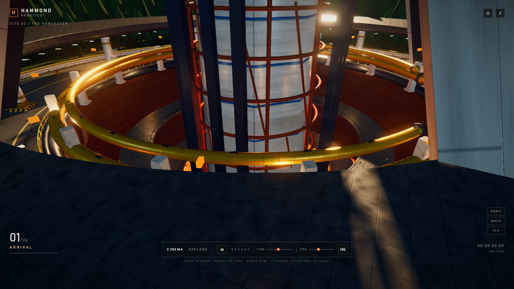
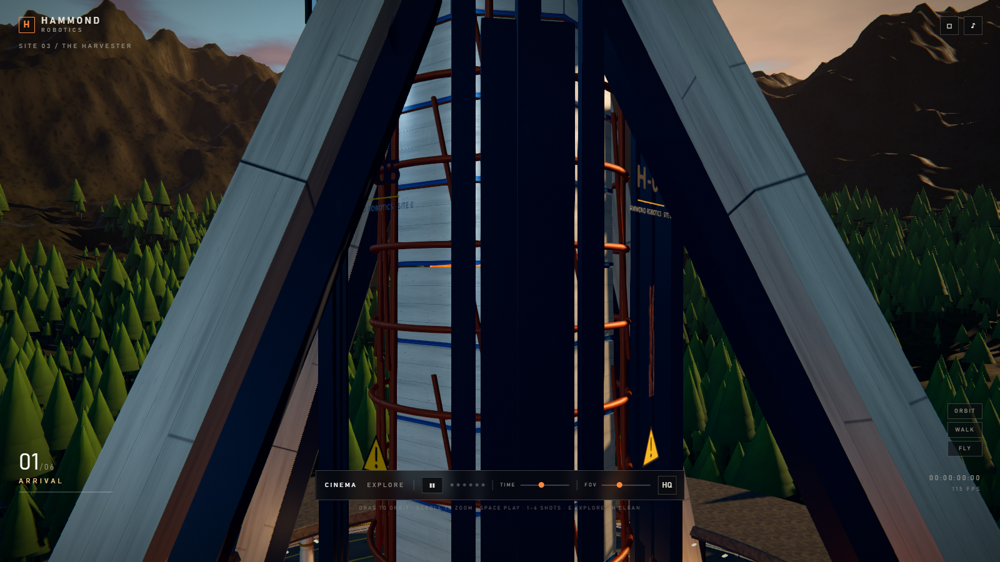

# HARVESTER — World's Edge 巨构场景 / 实时漫游 + 6 镜电影模式

Apex Legends 风格的单场景实时演示：Hammond Robotics 收割机（Harvester）坐落在裂谷盆地中央，
四臂外张的白色装甲塔身、中心熔岩核心、冲天能量束，周围是玄武岩台地、苔藓盆地、熔岩竖井，
塔基是碟形停靠平台与白色蓝条移动基地舱。

## 打开方式

- **双击 `HARVESTER-PV.html`** —— 单文件、离线、无需服务器。
- 或开发模式：`npm install && npm run build && npm run serve` → http://localhost:5173


## 画面

| | |
|---|---|
|  |  |
|  |  |
|  |  |

细节：井内检修栈道  · 贴花层 

## 操作

| 键 | 作用 |
|---|---|
| 空格 | 播放 / 暂停电影 |
| 1–6 | 跳转镜头 |
| ← → | 上一镜 / 下一镜 |
| E | 探索模式（轨道） |
| V | 第一人称步行 |
| F | 自由飞行 |
| H | 隐藏 HUD（干净画面） |
| 鼠标 | 拖动环视 / 锁定后转视角（ roam 模式） |
| Esc | 释放鼠标 |

时间滑块可切换 午后 → 黄金时刻 → 黄昏 → 夜晚。

## 场景构成

- **塔身**：中央八棱柱装甲柱（19 m 半径，102 m 高）+ 四条外张巨臂（16 m → 92 m 半径，
  30–46 m 宽）+ 顶部宽平冠盘（58 m 半径）+ 锈色桁架笼 + 熔岩核心（半径 8.4 m）
  + 能量束（1600 m，加法混合着色器）。总高约 220 m，臂展 184 m。
- **碟形平台**：半径 82 m 的 Lathe 车削碟体，含裙边蓝带、下层环廊、黄色管束、
  12 盏甲板泛光灯、中央熔岩竖井（半径 36 m，深 52 m）。
- **地形**：2.6 km 高度场地形（420×420 段），程序化 ridged noise 生成裂谷、
  二阶崖壁、远山；玄武岩台地用整体 butte 几何（非碎片堆叠）。
- **道具**：3 个停靠舱（46 m / 26 m / 22 m）、红色信标球、货柜、管线、护栏。
- **大气**：自定义天空着色器（三层渐变 + 云 + 火山烟柱 + 星点）+ PMREM 环境反射，
  指数雾、加法能量束、熔岩点光。

## 技术要点（踩过的坑）

1. **Loft 绕序**：自定义放样几何的三角形绕序反了会导致 PBR 材质被背面剔除 → 整片装甲"消失"。
   `loft.js` 里用有向体积自动判定并翻转。
2. **后期链顺序**：ACES 必须交给 `OutputPass`（配 `renderer.toneMapping`），
   调色放在 sRGB 之后；把 ACES 写进调色 pass 会把整幅压暗成灰。
3. **阴影相机**必须覆盖 220 m 塔身（±300 / top 340 / far 1500），否则塔顶不投影。
4. **山体不能用大量细长碎片**堆叠——会变成"柴火堆"；改用带竖棱和层理的整块 butte。
5. **峡谷开口**必须与相机方位角对齐（`RIFT_A`），并让太阳从这个开口照进盆地，
   否则盆地永远处在崖壁阴影里。

## 文件

```
index.html / style.css      开发页与 HUD
HARVESTER-PV.html           单文件成品（双击即开）
src/main.js                 渲染器、灯光、时间、漫游、debug 钩子
src/cinema.js               6 镜数据与状态机
src/hud.js                  电影/探索 HUD
src/lib/loft.js             放样几何（自动修正绕序）
src/lib/post.js             GTAO → DOF → Bloom → Output(ACES) → Grade → SMAA
src/lib/materials.js        材质库
src/lib/textures.js         程序化贴图（面板、岩石、地面、地面贴图）
src/world/harvester.js      收割机塔身
src/world/ring.js           碟形平台
src/world/terrain.js        高度场 + 玄武岩台地
src/world/props.js          停靠舱与地面道具
src/world/lava.js           熔岩着色器 + 竖井
src/world/sky.js            天空着色器与时间停止点
tools/shot.mjs              Puppeteer 截图
tools/pack.mjs              单文件打包
```

## 已知不足（诚实说明）

- 这是**实时风格化场景**，不是预渲染 CG；细节密度低于 Apex 官方原画。
- 塔身巨臂的截面仍偏"板"状，缺少原图那种多层装甲板叠加与铆钉细节。
- 岩壁贴图在远距离重复感明显，缺少近距离岩石细节资产。
- 角色、粒子特效（尘土/热浪）与音效尚未加入。
