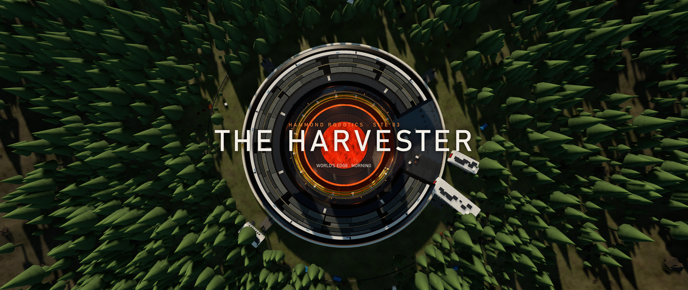
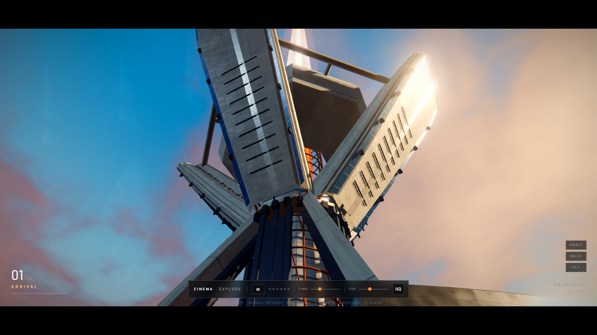
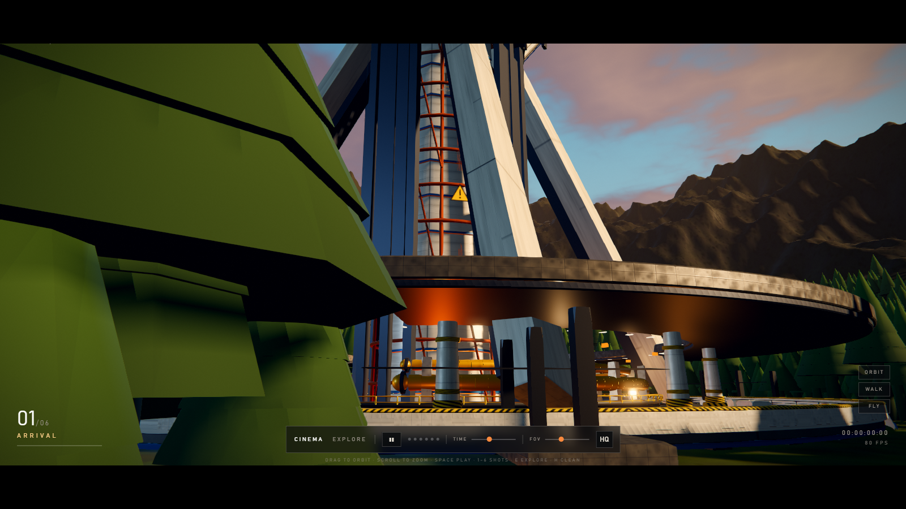
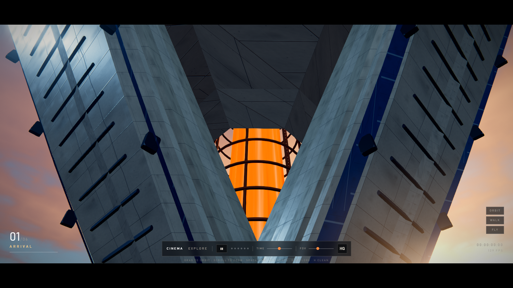
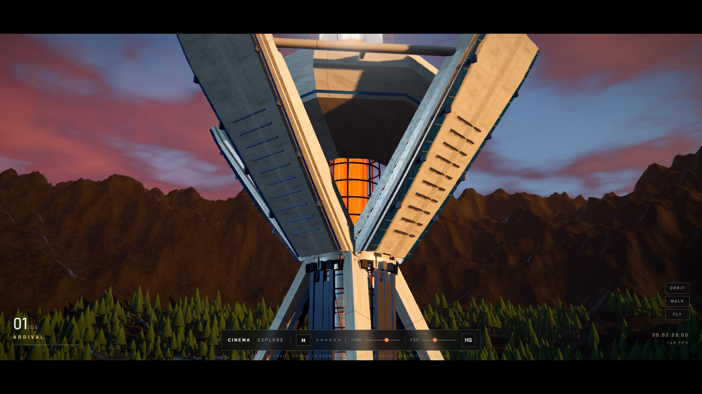
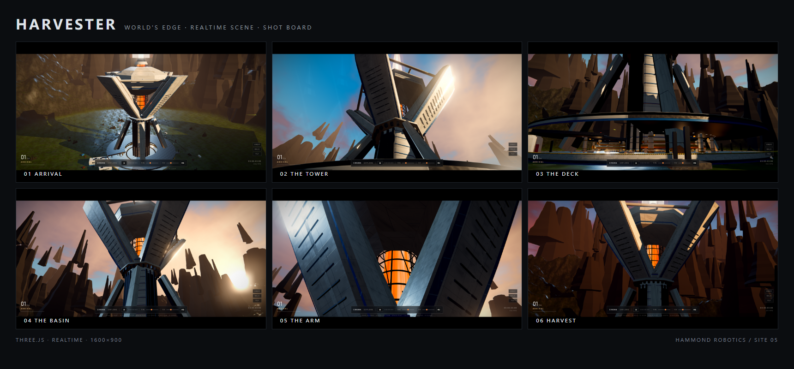

# HARVESTER — Apex-style Megastructure

## About

A single-scene, real-time environment study of the Hammond Robotics **Harvester** from Apex Legends'
World's Edge — rebuilt from reference stills in Three.js with no external assets.

Everything you see is generated at load: the armour plating and its panel lines, the rust truss cage,
the basalt buttes, the moss belt, ~7 000 conifers, the field modules and the stencilled decals.
The scene runs as a six-shot cinematic with a time-of-day slider, plus free explore, first-person
walk and free-fly modes.

**Scope** — 220 m tower, 184 m span, 95 m saucer station, a 48 m open lava shaft, 2.6 km of terrain.
**Status** — v0.0.9, playable vertical slice. Modelling detail and atmosphere work continue.
**Not** — a game, a plugin, or a pre-rendered film. One HTML file that opens by double-click.

Built with Three.js and hand-written shaders. No external assets: every texture, tree, rock and decal is generated procedurally at load.



> Real-time stylised environment, not pre-rendered CG. 1600×900 · 60–120 fps · ~2.9 M triangles.

---

## Open it

Double-click **`HARVESTER-PV.html`** — single file, fully offline, no server required.

Development:

```bash
npm install
npm run build      # esbuild bundle -> dist/app.js
npm run serve      # http://localhost:5199
npm run shot       # headless screenshot
npm run pack       # inline everything into HARVESTER-PV.html
```

## Controls

| Key | Action |
|---|---|
| `Space` | Play / pause the film |
| `1`–`6` | Jump to a shot |
| `←` `→` | Previous / next shot |
| `E` | Explore (orbit) |
| `V` | First-person walk |
| `F` | Free fly |
| `C` / `Q` | Descend (fly mode) |
| `D` | Toggle depth of field |
| `H` | Hide HUD |
| `Esc` | Release pointer |

The time slider walks the palette from afternoon through golden hour, dusk and night.

## Shots

| | |
|---|---|
|  |  |
|  |  |
|  |  |

Details: [well catwalks](docs/shots/detail-well.png) · [decals](docs/shots/detail-decals.png)

## What is in the scene

- **Tower** — 8-sided armoured column, four arms with a second outer skin and seam brackets, wide crown, rust truss cage, 8.4 m molten core, 1 600 m additive energy beam. 220 m tall, 184 m span.
- **Station** — 82 m lathe-turned saucer, blue hull band, lower catwalk ring, yellow pipe runs with capped ends, 2 maintenance rings inside the shaft, 14 practical lights.
- **Terrain** — 2.6 km heightfield (420²) with a two-stage foothill-to-ridge profile, a noise-warped moss belt, and 34 chunked basalt butte clusters.
- **Flora** — 330 forest patches (~7 000 conifers) with baked vertical colour gradients, split into 200 m cells for frustum culling; 420 boulders.
- **Decals** — stencilled hull codes, hazard triangles, rust runs and scorch marks.

## Technical notes

1. **Custom loft winding.** Hand-built loft geometry with reversed triangle order gets back-face culled and the armour silently disappears. `lib/loft.js` computes signed volume and flips when needed.
2. **Post order matters.** ACES belongs in `OutputPass`; grading must happen after the sRGB encode. Putting ACES inside the grade pass crushes the whole frame.
3. **Full-arc annuli.** Two `absarc` calls that share endpoints collapse into a solid disc after earcut — full rings must be built with `shape.holes`.
4. **Open-ended cylinders are single-sided.** They vanish from inside; anything seen from both sides needs real thickness.
5. **Shadows need a frustum that covers the subject** — a 220 m tower with a ±190 m shadow camera leaves the top unshadowed.
6. **Metalness is not decoration.** A `metalness: 0.9` surface with nothing to reflect renders black. Backlit steel needs albedo and lower metalness, not more lights.
7. **Volumetric light** is a half-res, 16-step screen-space raymarch inserted before Bloom. Each step takes one camera-depth sample and one sun-shadow sample, so the tower and forest actually cut the shafts. It costs two extra draw calls; the full stack runs at ~200–260 fps at 1600×900 on the dev machine, with the sun shadow map rebuilt only on cuts.
8. **TAA runs before volumetrics** and writes its resolve back into the composer readBuffer without swapping, so the scene depth attachment survives for the raymarch. Halton jitter is applied after the shot camera's projection update; history resets on every hard cut.
9. **Deck reflection** is a real planar mirror pass: the y=0 plane mirrors the camera with oblique near-plane clipping, renders only layer-2 tower/station/sky geometry at half resolution, and the deck material samples it with a Fresnel-weighted projection. The deck mesh stays off that layer so it never samples its own target.
10. **Dry soil ring** has its own ochre/gravel/crack texture and an `aDry` vertex mask; the ground shader mixes it over the moss map outside ~265 m and forces roughness toward 0.95 so it reads dry, not wet. The moss belt itself was expanded to a 373 m outer fade, roughly doubling the visible green area around the tower twice.

## Known gaps

- Crown now has three stacked armour tiers and blue trim; rivet rows and edge-wear detail are still lighter than the reference.
- Planar reflection is deck-only (no SSR for the rest of the station); TAA is Halton-jittered with depth reprojection, and volumetric light is a screen-space sun raymarch (half-res, 16 steps, depth + sun-shadow occlusion).
- Trees are stacked-cone impostors: fine at mid distance, readable as geometry within ~5 m.

## Layout

```
index.html / style.css        dev page + HUD
HARVESTER-PV.html             single-file build
src/main.js                   renderer, lights, time-of-day, roam, debug hooks
src/cinema.js                 six-shot data + state machine
src/hud.js                    film / explore HUD
src/lib/loft.js               lofting with automatic winding fix
src/lib/post.js               TAA → Volumetric → Bloom → Output(ACES) → Grade → SMAA
src/lib/reflection.js         deck planar reflection (mirror camera + layers)
src/lib/materials.js          material library
src/lib/textures.js           procedural canvas textures
src/world/harvester.js        the tower
src/world/ring.js             saucer station + shaft catwalks
src/world/terrain.js          heightfield, buttes, moss belt
src/world/flora.js            forest + boulders
src/world/props.js            field modules, containers, beacon
src/world/decals.js           stencils, hazard plates, rust
src/world/lava.js             lava shader + shaft
src/world/sky.js              sky shader + time stops
tools/shot.mjs               puppeteer capture
tools/pack.mjs                single-file packer
```
